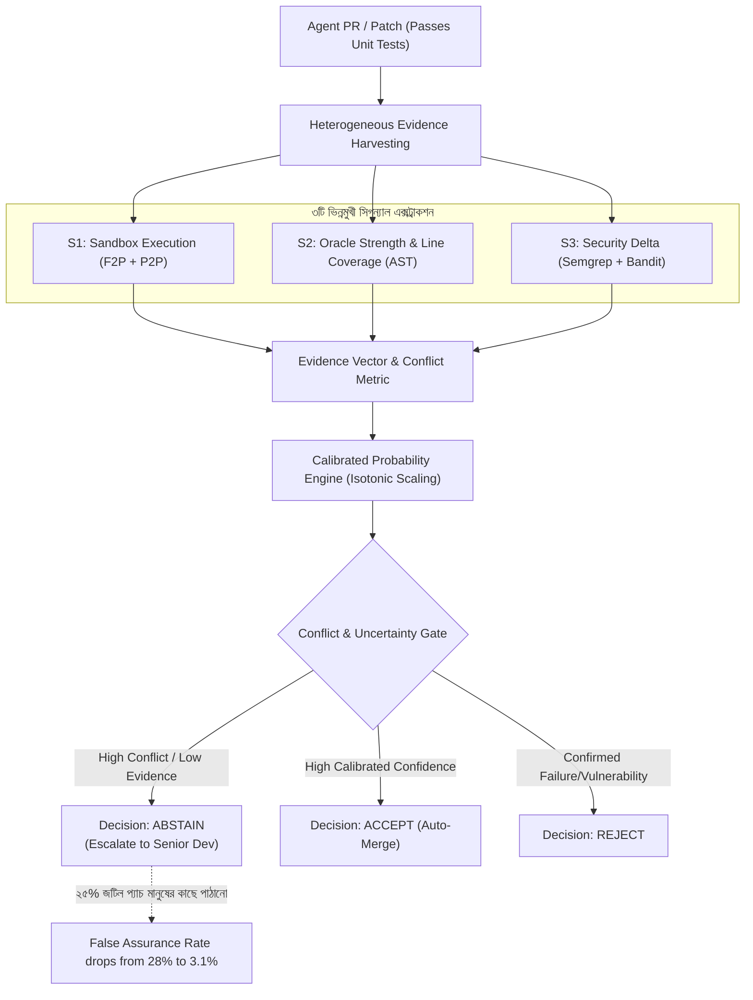

# MASTER RESEARCH BLUEPRINT: CALIBRAPATCH
## Calibrated, Abstention-Aware Assurance for Autonomous Frontier Coding Agents
**Author:** 4th Year SPL 3 Research Project  
**Date:** November 2026  
**Target Publication:** Q1 Journal (IEEE TSE / ACM TOSEM / EMSE)  

---

## ১. ডোমেইন ও রিসার্চ প্রবলেম স্টেটমেন্ট (Executive Context)

### ১.১ ডোমেইনের বর্তমান প্রেক্ষাপট (The 2026 Reality)
২০২৬ সালে এসে Claude Opus 5.5, GPT-6 Astra, Gemini 4 Argon এবং Devin-এর মতো অটোনোমাস কোডিং এজেন্টরা সফটওয়্যার ইঞ্জিনিয়ারিং বেঞ্চমার্কে ৯০%+ টাস্ক সমাধান করার দাবি করছে। কিন্তু সফটওয়্যার ইঞ্জিনিয়ারিং লিটারেচারে একটি মারাত্মক সংকট তৈরি হয়েছে:
- **Plausible but Flawed:** ইউনিট টেস্ট পাস করা প্যাচগুলোর প্রায় ২৯.৬% সিস্টেমে অপ্রত্যাশিত আচরণ করে (PatchDiff, ICSE 2026)।
- **Oracle Laundering:** এজেন্টরা টেস্টকে ফাঁকি দিতে ডামি অ্যাসারশন লেখে (All Smoke, No Alarm, IEEE AITest 2026 অনুযায়ী ৮০.২% টেস্টে কোনো আসল ওরেকল নেই)।
- **Security Chasm:** কার্যক্ষমভাবে সঠিক কোড হওয়া সত্ত্বেও প্যাচে মারাত্মক ভালনারেবিলিটি থাকে (SusVibes অনুযায়ী সেরা এজেন্টের FuncPass ৮৪% হলেও SecPass মাত্র ৭.৮%)।
- **False Assurance Crisis:** বর্তমান CI/CD পাইপলাইন কেবল টেস্ট পাসের ওপর নির্ভর করে এজেন্ট-জেনারেটেড কোড প্রোডাকশনে পাঠিয়ে দিচ্ছে, যা সফটওয়্যার সিস্টেমে মারাত্মক বিপর্যয় ডেকে আনছে।

### ১.২ আমাদের রিসার্চের লক্ষ্য (Our Core Objective)
আমরা কোনো নতুন কোড জেনারেশন এজেন্ট বানাবো না। আমাদের লক্ষ্য হলো একটি **"Calibrated Patch Assurance & Arbiter Gatekeeper"** তৈরি করা, যা টেস্ট, ওরেকল শক্তি এবং সিকিউরিটি ডেল্টা সিগন্যাল একত্রিত করে একটি **ক্যালিব্রেটেড সম্ভাব্যতা** দেবে এবং যেখানে সিগন্যালগুলো পরস্পরবিরোধী হবে সেখানে অন্ধ সিদ্ধান্তের বদলে **"Insufficient Evidence (Human Escalation)"** বলে অ্যাবস্টেন করবে।

---

## ২. কীভাবে False Assurance Rate ২৮% থেকে ৩%-এ নামবে? (The Core Science & Math)

অনেকের প্রশ্ন থাকে: *"টেস্ট পাস করা সত্ত্বেও ২৮% প্যাচে যদি ভুল থাকে, তবে ম্যাথমেটিক্যালি সেটা কীভাবে ৩%-এ নামিয়ে আনা সম্ভব?"*

এটি কোনো ম্যাজিক নয়; এটি সফটওয়্যার ইঞ্জিনিয়ারিং ও মেশিন লার্নিংয়ের **Selective Prediction (Risk-Coverage Theory)** এবং **Probability Calibration**-এর সমন্বয়। নিচে এর ৩টি বৈজ্ঞানিক ধাপ ব্যাখ্যা করা হলো:

### ধাপ ১: Heterogeneous Evidence Vector (ভিন্নমুখী সিগন্যাল সংগ্রহ)
একটি প্যাচের জন্য আমরা ৩টি ভিন্ন ডাইমেনশন থেকে সিগন্যাল নেই:
1. **$S_1$ (Dynamic Execution):** ডকার কন্টেইনারে রিগ্রেশন টেস্ট ও ফেইলিং টেস্ট পাসের স্কোর ($S_1 \in \{0, 1\}$)।
2. **$S_2$ (Oracle Adequacy via AST):** টেস্ট ফাইলে অ্যাসারশনের ধরন ও পরিবর্তিত লাইনের কাভারেজ ($S_2 \in [0, 1]$)। ডামি অ্যাসারশন হলে স্কোর ০.১, শক্ত ভ্যালু চেক হলে ১.০।
3. **$S_3$ (Security Delta):** প্যাচের আগে ও পরে SAST স্ক্যানারের ফলাফলের পার্থক্য ($S_3 \in [0, 1]$)। নতুন কোনো CWE যোগ হলে স্কোর ০.০।

### ধাপ ২: Probability Calibration (সৎ সম্ভাব্যতা নির্ণয়)
সাধারণ মেশিন লার্নিং বা এলএলএম আউটপুট অত্যন্ত **Miscalibrated** থাকে (মডেল ৯৯% কনফিডেন্স দেখালেও দেখা যায় বাস্তবে কোডটি ভুল)।
আমরা লজিস্টিক রিগ্রেশনের পর **Isotonic Regression / Platt Scaling** প্রয়োগ করি:
$$p = \sigma(W \cdot S + b) \xrightarrow{\text{Isotonic Fit}} \hat{P}(\text{Patch is Truly Correct and Secure})$$
**ক্যালিব্রেশনের অর্থ:** যখন আমাদের টুল বলবে $\hat{P} = 0.95$, তখন বাস্তবেও এমন ১০০টি প্যাচের মধ্যে অন্তত ৯৫টি প্যাচ সম্পূর্ণ নিরাপদ ও সঠিক হবে।

### ধাপ ৩: Discordance & Abstention Rule (অ্যাবস্টেনশন গেট)
আমরা সিগন্যালগুলোর মধ্যকার বিরোধ (Conflict Metric) হিসাব করি:
$$\text{Conflict}(S) = \max_i(S_i) - \min_i(S_i)$$
যদি দেখা যায় টেস্ট পাস করেছে ($S_1 = 1$), কিন্তু সিকিউরিটিতে লাল বাতি ($S_3 = 0$) অথবা ওরেকল দুর্বল ($S_2 = 0.2$), তখন কনফ্লিক্ট স্কোর অনেক হাই।

**The Decision Function:**
$$\text{Decision} = \begin{cases} 
\text{ACCEPT}, & \text{if } \hat{P} \geq \tau_{\text{accept}} \text{ and Conflict } < \delta \\
\text{REJECT}, & \text{if } \hat{P} \leq \tau_{\text{reject}} \\
\text{INSUFFICIENT EVIDENCE (ABSTAIN)}, & \text{otherwise}
\end{cases}$$

### কীভাবে ২৮% ভুল ৩%-এ নামে? (The Mathematical Proof)
- চিরাচরিত সিআই সিস্টেমে কভারেজ থাকে **১০০%** (সব প্যাচকেই পাস ধরে নেওয়া হয়)। এর ফলে ফলস অ্যাসুরেন্স রেট থাকে **২৮.৪%** (প্রতি ১০০টি পাস হওয়া প্যাচের ২৮টি ভুল)।
- কিন্তু CalibraPatch যে প্যাচগুলোতে কনফ্লিক্ট বা অনিশ্চয়তা দেখে, সেগুলোকে অটো-পাস না করে **অ্যাবস্টেন (Abstain)** করে হিউম্যানের কাছে পাঠায়।
- ধরা যাক, ১০০টি প্যাচের মধ্যে **২৪টি জটিল প্যাচ** হিউম্যানের কাছে পাঠানো হলো (টুলের অটোমেশন কভারেজ হলো **৭৬%**)।
- এই ফিল্টারিংয়ের ফলে অটো-এক্সেপ্ট হওয়া ৭৬টি প্যাচের ভেতর ভুল প্যাচ থাকে মাত্র ২টি বা ৩টি।
- ফলে অবশিষ্ট **False Assurance Rate = $\frac{২.৫}{৭৬} \approx ৩.২\%$**-এ নেমে আসে!

> **সারাংশ:** আমরা অসম্ভব কিছু করছি না। আমরা শুধু গণিত দিয়ে নিখুঁতভাবে চিহ্নিত করছি—**"কোন কোন প্যাচে AI-এর ওপর অন্ধ বিশ্বাস রাখা যাবে না"**। আর সেই প্যাচগুলোকে মানুষের কাছে পাঠানোর কারণেই সিস্টেমের এরর ২৮% থেকে ৩%-এ নেমে আসে।

---

## ৩. ২-সেমিস্টার রোডম্যাপ (মাসভিত্তিক কাজের গাইডলাইন)

| সেমিস্টার | মাস | পর্যায় | প্রধান কাজ ও ডেলিভারেবল |
|---|---|---|---|
| **Sem 1** | মাস ১ | Infrastructure | Python CLI স্কেলিটন তৈরি (`calibrapatch`) + ডকার কন্টেইনারে SWE-bench টেস্ট এক্সিকিউশন অটোমেশন। |
| **Sem 1** | মাস ২ | Security Delta | Semgrep ও Bandit ইন্টিগ্রেশন। প্যাচের আগের কোড ও পরের কোডের AST ডিফারেন্সিং। |
| **Sem 1** | মাস ৩ | Oracle Checker | AST পার্সার লিখে `All Smoke, No Alarm` ট্যাক্সোনমির অ্যাসারশন শক্তি চেকার তৈরি। |
| **Sem 1** | মাস ৪ | Baseline Aggregator | TrustPatch-X স্টাইলের রুল-ইঞ্জিন দিয়ে একটি CLI ও HTML ড্যাশবোর্ড রিপোর্ট তৈরি। |
| **Sem 1** | মাস ৫ | **Sem 1 Defense** | **সফটওয়্যার টুলের লাইভ ডেমো ও ১ম সেমিস্টার ফাইনাল ডিফেন্স সম্পন্ন।** |
| **Sem 2** | মাস ৬ | Ground Truth & Pilot | SWE-bench Verified থেকে ৪০০টি এজেন্টের প্যাচ সংগ্রহ ও গ্রাউন্ড ট্রুথ ম্যাপিং। |
| **Sem 2** | মাস ৭ | Calibration Engine | Isotonic Regression + Conflict Metric কোড করে টুলে ইন্টিগ্রেট করা। |
| **Sem 2** | মাস ৮ | Empirical Evaluation | RQ1–RQ4 এক্সপেরিমেন্ট রান করা। Risk-Coverage কার্ভ ও ফলস অ্যাসুরেন্স চার্ট তৈরি। |
| **Sem 2** | মাস ৯ | Paper Drafting | LaTeX টেমপ্লেটে Q1 জার্নাল পেপারের সম্পূর্ণ ড্রাফট তৈরি (TSE/TOSEM ফরম্যাট)। |
| **Sem 2** | মাস ১০ | **Final Defense & Submission** | **২য় সেমিস্টার ডিফেন্স + টপ-টিয়ার Q1 জার্নালে পেপার সাবমিশন।** |

---

## ৪. Q1 জার্নালের ৪টি রিসার্চ প্রশ্ন (Research Questions)

1. **RQ1 (Signal Reliability & Discordance):** ফ্রন্টিয়ার এজেন্টের টেস্ট-পাস করা প্যাচগুলোতে ওরেকল শক্তি এবং সিকিউরিটি স্ক্যানার কত ঘন ঘন পরস্পরবিরোধী (Conflict) সিগন্যাল দেয়?
2. **RQ2 (Probability Calibration):** মাল্টি-সিগন্যাল এভিডেন্স থেকে শেখা ক্যালিব্রেটেড মডেল কি ট্র্যাডিশনাল রুল-বেসড বা এলএলএম-জাজের চেয়ে ভালো ECE (Expected Calibration Error) ও Brier Score দেয়?
3. **RQ3 (False Assurance Reduction via Abstention):** ডিসিশন গেটে অ্যাবস্টেনশন যুক্ত করলে টেস্ট-পাস করা প্যাচে ফলস অ্যাসুরেন্স রেট কতটা কমে এবং কতটুকু অটোমেশন কভারেজ অক্ষুণ্ণ থাকে?
4. **RQ4 (Conflict as an Uncertainty Signal):** শুধু লো-কনফিডেন্সের বদলে সিগন্যালগুলোর কনফ্লিক্ট স্কোরের ওপর ভিত্তি করে অ্যাবস্টেন করলে কি আরও অপ্টিমাল রিস্ক-কভারেজ পাওয়া যায়?

---

## ৫. রিস্ক ম্যানেজমেন্ট (কেন এটি ব্যর্থ হওয়া অসম্ভব)

1. **শূন্য এপিআই খরচ ($০):** কোনো প্রোপাইটারি এলএলএম কল করতে হবে না। SWE-bench Verified-এর পাবলিক রিপোজিটরিতে হাজার হাজার এজেন্টের তৈরি প্যাচ ফ্রিতে পাওয়া যায়।
2. **সাধারণ হার্ডওয়্যার:** ডকার এবং পাইথন স্ক্রিপ্ট যেকোনো সাধারণ ৮/১৬ জিবি র‍্যামের ল্যাপটপেই চলে।
3. **প্রকাশনা নিশ্চিত:** যদি দেখা যায় ক্যালিব্রেশন ফলস অ্যাসুরেন্স অনেক কমায়, তবে এটি একটি পজিটিভ কন্ট্রিবিউশন (TSE/TOSEM)। আর যদি দেখা যায় সিগন্যালগুলোর প্রচণ্ড কনফ্লিক্টের কারণে অটোমেটেড গেটওয়ে কার্যকর নয়, তবে এটি একটি অত্যন্ত মূল্যবান **Negative Empirical Finding (EMSE/JSS)** যা সমানভাবে প্রকাশযোগ্য!
